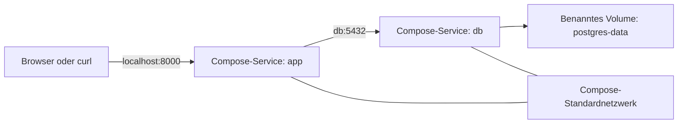

# Stack mit Docker Compose starten

[Docker Compose](https://docs.docker.com/compose/) beschreibt eine Multi-Container-Anwendung in einer einzigen YAML-Datei. Es ersetzt die wiederholten Befehle für Build, Netzwerk, Volume, Umgebung und Start aus Lektion 4 und behält dabei dieselben Service-Grenzen bei.

## Compose-Architektur



Compose erstellt automatisch ein Projektnetzwerk. Service-Namen werden in diesem Netzwerk zu DNS-Hostnamen. Deshalb verbindet sich die API mit `db`, nicht mit `localhost`.

Compose stellt Volume-Namen außerdem den Projektnamen als Präfix voran. Das Compose-Volume `postgres-data` ist getrennt vom Volume ohne Präfix aus den Lektionen 2 und 4. Deshalb startet der erste Compose-Lauf mit einer neuen Datenbank. Spätere Compose-Läufe verwenden diese Datenbank wieder, solange ihr Volume nicht entfernt wird.

## Die Compose-Datei

[`docker-compose.yaml`](docker-compose.yaml) definiert den kompletten Stack:

```yaml
services:
  db:
    image: postgres:17
    environment:
      POSTGRES_USER: ${POSTGRES_USER}
      POSTGRES_PASSWORD: ${POSTGRES_PASSWORD}
      POSTGRES_DB: ${POSTGRES_DB}
    ports:
      - "5432:5432"
    volumes:
      - postgres-data:/var/lib/postgresql/data
    healthcheck:
      test: ["CMD-SHELL", "pg_isready -U ${POSTGRES_USER} -d ${POSTGRES_DB}"]
      interval: 5s
      timeout: 5s
      retries: 10

  app:
    build:
      context: .
      dockerfile: service/Dockerfile
    environment:
      DB_CONN: postgresql+psycopg://${POSTGRES_USER}:${POSTGRES_PASSWORD}@db:5432/${POSTGRES_DB}
    ports:
      - "8000:8000"
    healthcheck:
      test:
        - CMD
        - python
        - -c
        - import urllib.request; urllib.request.urlopen('http://localhost:8000/', timeout=2)
      interval: 5s
      timeout: 3s
      retries: 10
      start_period: 5s
    depends_on:
      db:
        condition: service_healthy

volumes:
  postgres-data:
```

## So liest du die Konfiguration

| Feld | Rolle in diesem Stack |
| --- | --- |
| `image` | Das offizielle PostgreSQL-Image herunterladen |
| `build` | Die API mit ihrem Dockerfile und dem Kontext im Stammverzeichnis bauen |
| `environment` | Konfiguration pro Container zur Laufzeit übergeben |
| `ports` | Ports der Services für den Host freigeben |
| `volumes` | PostgreSQL-Daten unabhängig von Containern dauerhaft speichern |
| `healthcheck` | Bereitschaft der Datenbank und HTTP-Erreichbarkeit der API prüfen |
| `depends_on` | Vor dem Start der API auf den Health-Status der Datenbank warten |

Die Ausdrücke `${...}` werden aus der ignorierten Datei `.env` im Stammverzeichnis eingesetzt. Die aufgelöste Datenbank-URL verwendet `db`, weil das der Name des Datenbank-Service im Compose-Netzwerk ist.

## Aufgelöste Konfiguration validieren

Erstelle bei Bedarf `.env` und lass Compose dann die finale Konfiguration ausgeben:

```bash
cp .env.example .env
docker compose config
```

Sieh dir die Ausgabe an, bevor du Services startest. So findest du fehlende Variablen, ungültiges YAML und Fehler in Pfaden. Die Ausgabe enthält die Zugangsdaten für die Entwicklung. Veröffentliche sie deshalb nicht als Build-Artefakt und protokolliere sie nicht in einem gemeinsam genutzten Produktivsystem.

## Stack bauen und starten

```bash
docker compose up --build --wait
```

Was Compose jetzt tut:

1. erstellt das Projektnetzwerk und das benannte Volume,
2. startet PostgreSQL,
3. wartet auf den Healthcheck der Datenbank,
4. baut und startet die API,
5. wartet auf den Healthcheck der API,
6. gibt die Ports `5432` und `8000` für den Host frei.


*Diagramm auf Grundlage der offiziellen Docker-Anleitung zur [Startreihenfolge in Compose](https://docs.docker.com/compose/how-tos/startup-order/).*

## Laufzeitzustand beobachten

```bash
docker compose ps
docker compose logs db
docker compose logs app
docker compose logs -f
```

`docker compose ps` sollte sowohl die Datenbank als auch die API als healthy anzeigen.

## API ausprobieren

```bash
curl http://localhost:8000/

curl -X POST http://localhost:8000/users \
    -H "Content-Type: application/json" \
    -d '{"name":"Jane Doe","email":"jane.doe@example.com"}'

curl http://localhost:8000/users
```

Dieselbe Swagger UI ist weiterhin unter <http://localhost:8000/docs> erreichbar. Die Containerisierung ändert die Art des Deployments, nicht den API-Vertrag.

## Nach Codeänderungen neu bauen

Das Image enthält eine Kopie von `service/`. Änderungen am Quellcode erfordern deshalb einen neuen Build:

```bash
docker compose up --build --wait app
```

Dieses Repository verzichtet absichtlich auf einen Bind-Mount für die Entwicklung. Die Lektion zeigt reproduzierbare Image-Builds statt einer Entwicklung mit Live-Reload im Container.

## Stack stoppen oder zurücksetzen

Stoppe und entferne die Container und das Projektnetzwerk, wobei die Daten der Datenbank erhalten bleiben:

```bash
docker compose down
```

Lösche das benannte Volume der Datenbank nur dann zusätzlich, wenn du alles vollständig zurücksetzen möchtest:

```bash
docker compose down --volumes
```

## Checkpoint

**Was bringt der Healthcheck von PostgreSQL über die Startreihenfolge der Container hinaus?**

**Antwort:** Ein laufender PostgreSQL-Prozess initialisiert sich womöglich noch und kann noch keine Abfragen annehmen. Der Healthcheck prüft die Bereitschaft, und die Bedingung in der Langform von `depends_on` verzögert den Start der API, bis diese Bereitschaftsprüfung erfolgreich ist.

## Zusammenfassung

Docker Compose drückt dieselbe Architektur mit zwei Services jetzt als versionierte Konfiguration aus. Ein einziger Befehl baut das Image der API aus der Lock-Datei, startet beide Services in der Reihenfolge ihrer Abhängigkeiten, erstellt ihr privates Netzwerk und bindet dauerhaften Speicher für die Datenbank ein.
