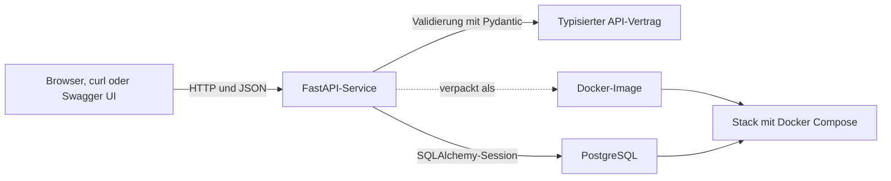

# APIs, PostgreSQL und Docker

In diesem Repository wächst ein kleiner Webservice von den JSON-Grundlagen bis zu einer typisierten CRUD-API mit [FastAPI](https://fastapi.tiangolo.com/), die auf [PostgreSQL](https://www.postgresql.org/docs/) und [SQLAlchemy](https://docs.sqlalchemy.org/en/20/) aufsetzt. Danach wird der Service mit [Docker](https://docs.docker.com/) verpackt und der komplette Stack mit [Docker Compose](https://docs.docker.com/compose/) gestartet.

## Lernpfad

1. [**Einstieg in JSON**](01-intro-to-json.ipynb): JSON-Text von Python-Objekten unterscheiden, API-Responses einlesen und Daten mit Pydantic validieren.
2. [**Einführung in Docker**](02-intro-to-docker.md): PostgreSQL aus seinem offiziellen Image starten, die Daten dauerhaft speichern und die Datenbank untersuchen.
3. [**Einführung in FastAPI**](03-intro-to-fastapi.md): typisierte Verträge für Request und Response sowie eine CRUD-API auf Basis von SQLAlchemy implementieren.
4. [**FastAPI und Docker**](04-intro-to-docker-part2.md): das Image der API bauen und zwei Container über ein benutzerdefiniertes Netzwerk verbinden.
5. [**Docker Compose**](05-intro-to-docker-compose.md): API und Datenbank als eine Multi-Container-Anwendung beschreiben und betreiben.

## Architektur



Die ersten drei Lektionen zeigen jede Systemgrenze einzeln. Die letzten beiden behalten denselben Vertrag für API und Datenbank bei, ändern aber, wo die Prozesse laufen und wie sie ihre Konfiguration erhalten.

## Lernziele

Am Ende dieses Repositorys kannst du:

- eine REST-API mit FastAPI und typisierten Pydantic-Modellen für Request und Response erstellen.
- CRUD-Endpoints implementieren, die über SQLAlchemy-Sessions aus PostgreSQL lesen und in PostgreSQL schreiben.
- ein Dockerfile für die Python-API schreiben und API und Datenbank gemeinsam mit Docker Compose starten.

## Voraussetzungen

- [uv](https://docs.astral.sh/uv/getting-started/installation/) für Python 3.13 und die Verwaltung der Abhängigkeiten
- [Docker Desktop](https://docs.docker.com/desktop/) mit dem Befehl `docker compose`
- [VS Code](https://code.visualstudio.com/) oder ein anderer Editor, der Jupyter-Notebooks unterstützt

`psql` lokal zu installieren ist optional. Die Docker-Lektion enthält einen Befehl `docker exec ... psql`, der ohne Installation auf dem Host funktioniert.

## Setup

> [!NOTE]
> Text in spitzen Klammern wie `<repo-name>` ist ein Platzhalter. Ersetze den kompletten Platzhalter samt den Klammern durch deinen eigenen Wert.

### 1. Repository aus dem Template erstellen

Klicke auf GitHub auf **Use this template**. Lege dich selbst als Owner fest, gib dem Repository einen Namen und deaktiviere **Include all branches**.

Wenn du in einer Gruppe arbeitest, erstellt eine Person das Repository und fügt dann die anderen Teilnehmenden unter **Settings -> Collaborators** hinzu.

### 2. Repository klonen und in den Ordner wechseln

```bash
git clone <copied-ssh-url>
cd <repo-name>
```

### 3. Python-Umgebung installieren

Die Lock-Datei hält alle Abhängigkeiten vollständig fest. Dieser Befehl installiert bei Bedarf Python 3.13 und erstellt `.venv/` automatisch:

```bash
uv sync --locked
```

### 4. Lokale Konfiguration erstellen

```bash
cp .env.example .env
```

Die mitgelieferten Werte sind Zugangsdaten für den lokalen PostgreSQL-Container und nur für die Entwicklung gedacht. Verwende sie nicht für eine gemeinsam genutzte Datenbank oder eine Produktivdatenbank.

### 5. Projekt öffnen

```bash
code .
```

Wähle die von `uv sync` erstellte Umgebung `.venv` aus, wenn VS Code nach einem Kernel für das Notebook fragt.

## Kompletten Stack starten

Wenn du `.env` erstellt hast, baue das Image der API und starte PostgreSQL und FastAPI:

```bash
docker compose up --build --wait
curl http://localhost:8000/
docker compose down
```

Die erwartete Status-Response lautet:

```json
{"status":"ok"}
```

## Struktur des Repositorys

```text
.
├── assets/                     # Grafiken mit Quellenangaben für die Lektionen
├── data/                       # JSON-Dateien, die das Notebook erzeugt
├── service/                    # FastAPI-Anwendung und Dockerfile der API
├── 01-intro-to-json.ipynb
├── 02-intro-to-docker.md
├── 03-intro-to-fastapi.md
├── 04-intro-to-docker-part2.md
├── 05-intro-to-docker-compose.md
├── docker-compose.yaml
├── pyproject.toml
└── uv.lock
```

## Quellen und weiterführende Literatur

- [FastAPI-Tutorial](https://fastapi.tiangolo.com/tutorial/)
- [SQLAlchemy Unified Tutorial](https://docs.sqlalchemy.org/en/20/tutorial/)
- [Pydantic-Modelle](https://docs.pydantic.dev/latest/concepts/models/)
- [Überblick über Netzwerke in Docker](https://docs.docker.com/engine/network/)
- [Einstieg in Docker Compose](https://docs.docker.com/compose/gettingstarted/)
